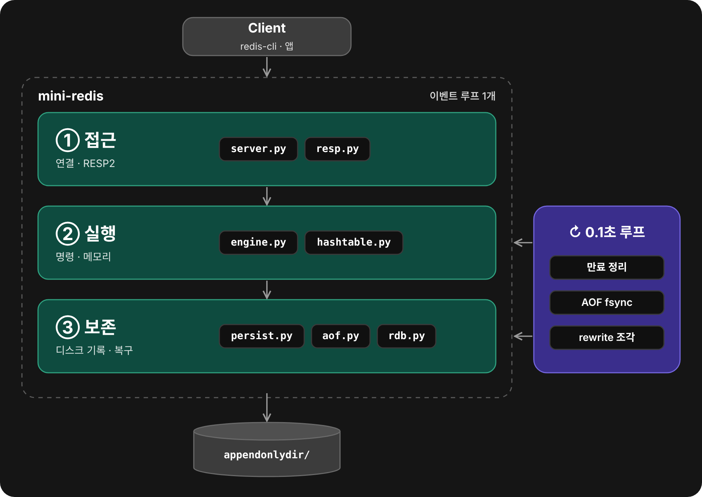
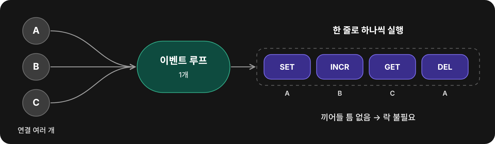
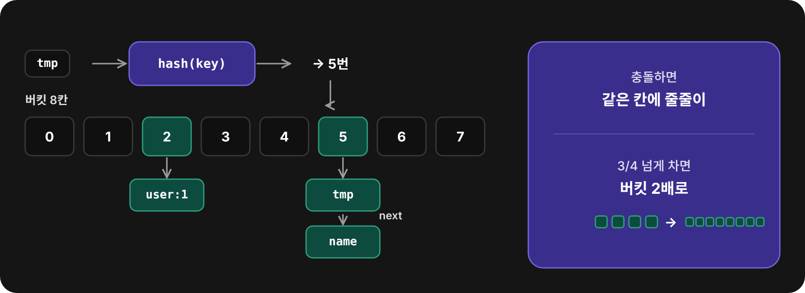

<div align="center">


# Mini Redis

### Python 표준 라이브러리로 만든 단일 노드 Redis

**연결은 여러 개, 실행은 한 줄로. 기록은 먼저, 만료는 읽을 때와 틈날 때.**


[](#quick-start)
[](#design-goals)
[](#client-side)
[](#engine-side)
[](#benchmark)

</div>

<br />

## Quick Start

Python 3.9 이상, 외부 패키지 없음.

```sh
python3 -m miniredis                  # 127.0.0.1:6379, ./appendonlydir/에 저장
```

```sh
redis-cli SET visits 9 EX 60          # OK
redis-cli INCR visits                 # 10
redis-cli HSET user:42 city Seoul     # (integer) 1
redis-cli TTL visits                  # (integer) 60
```

메모리 전용: `python3 -m miniredis -addr 127.0.0.1:6380 -aof ''`

<br />

## Design Goals

| 과제 | 해결 | 코드 |
| --- | --- | --- |
| **동시성** | 싱글 스레드. 이벤트 루프 1개 + `await` 없는 `execute` → 명령이 섞이지 않아 락 불필요 | [server.py](miniredis/server.py) · [engine.py](miniredis/engine.py) |
| **만료된 값** | 접근 시 검사해 삭제 + 0.1초 루프가 20개씩 이어서 정리 | [engine.py](miniredis/engine.py) |
| **외부 API** | Redis와 같은 RESP2 over TCP → `redis-cli` 그대로 사용. HTTP 캐시 예제 포함 | [resp.py](miniredis/resp.py) · [examples/](examples) |
| **무효화** | `DEL` · `EXPIRE` · `SET` 덮어쓰기. AOF에 남아 재시작 후에도 유지 | [engine.py](miniredis/engine.py) |
| **서버 다운 대비** | AOF에 먼저 기록 → 메모리 반영. base RDB + incr AOF + manifest로 복구 | [persist.py](miniredis/persist.py) |

<br />

## Client Side

### 요청 흐름


1. **읽기** — 연결마다 RESP2 명령을 하나씩 읽음. 기다리는 동안 다른 연결 처리
2. **실행** — 명령 하나를 끝까지 실행. 쓰기는 AOF에 먼저 기록 후 메모리 반영
3. **응답** — RESP2로 돌려줌. 파이프라인은 보낸 순서대로

### 지원 명령

| 종류 | 명령 |
| --- | --- |
| 문자열 | `SET` (`EX`, `NX`) · `GET` · `INCR` · `MSET` · `MGET` |
| 해시 | `HSET` · `HGET` |
| 키 | `DEL` · `EXISTS` · `TYPE` · `EXPIRE` · `TTL` |
| 서버 | `PING` · `BGREWRITEAOF` |

### API로 쓰기 — 캐시 예제

SQLite 주문 8만 건 집계를 Mini Redis에 캐시하는 HTTP API.

```sh
python3 -m examples.cache_api --db orders.sqlite3 --cache on --ttl 30
curl -i http://127.0.0.1:8080/reports/1    # X-Cache: MISS → SQLite 집계 후 SET ... EX 30
curl -i http://127.0.0.1:8080/reports/1    # X-Cache: HIT  → Mini Redis에서 응답
```

DB가 바뀌면 `DEL`로 바로 무효화. Mini Redis가 꺼져 있으면 `X-Cache: UNAVAILABLE`로 SQLite 결과 반환.

<br />

## Engine Side

### 전체 구조



| 레이어 | 역할 |
| --- | --- |
| ① 접근 | TCP 연결 · RESP2 읽기/쓰기 |
| ② 실행 | 명령 검사 · 키 공간 읽기/쓰기 · 만료 판정 |
| ③ 보존 | AOF 기록 · RDB 스냅샷 · 시작 시 복구 |
| 0.1초 루프 | 만료 정리 · fsync · rewrite 조각 쓰기 |

### 동시성 — 싱글 스레드



연결은 여러 개, 실행은 한 줄. `await`는 소켓을 기다릴 때만 있고 `execute`는 동기 함수라 **명령 단위로 원자적**. `INCR`을 동시에 보내도 값이 꼬이지 않음. 실제 Redis도 명령 실행은 스레드 하나.

### 키 공간 — HashTable



직접 구현한 [`HashTable`](miniredis/hashtable.py). 충돌은 같은 버킷에 `next`로 연결(chaining), 3/4 넘게 차면 버킷 2배. 해시의 필드는 Python `dict` 사용.

### 만료


- **접근 시 검사** — 읽을 때 만료됐으면 지우고 nil
- **0.1초 루프** — 앞에서 20개씩 검사, 살아 있는 키는 뒤로 보내 다음 루프가 이어서 검사

### 무효화

| 명령 | 동작 | AOF 기록 |
| --- | --- | --- |
| `DEL k` | 즉시 삭제 | `DEL k` (있던 키만) |
| `EXPIRE k s` | 기한 예약, 0 이하면 즉시 삭제 | `PEXPIREAT k <ms>` |
| `SET k v` | 새 값으로 교체, TTL 해제 | `SET k v [PXAT <ms>]` |

### 영속화


Redis 7과 같은 `appendonlydir/` 구조.

- **manifest** — 지금 읽을 파일 목록
- **base.rdb** — 한 시점의 스냅샷
- **incr.aof** — 스냅샷 이후 쓰기 기록

rewrite 중에 꺼져도 manifest가 이전 파일을 가리켜 안전.

| `-appendfsync` | fsync 시점 | 전원이 꺼지면 |
| --- | --- | --- |
| `always` | 응답 전 매번 | 손실 없음 |
| `everysec` (기본) | 약 1초마다 | 최대 약 1초 |
| `no` | OS에 맡김 | OS에 따라 |

<br />

## Benchmark

### 캐시 사용 전후

주문 8만 건, 보고서 8개를 클라이언트 하나가 순환 요청. 요청마다 새 HTTP 연결, 응답은 SQLite 원본과 대조.


| 처리 방식 | 요청 수 | 중앙값 | p95 | 초당 처리량 |
| --- | ---: | ---: | ---: | ---: |
| 캐시 끔 · SQLite 직접 집계 | 4,800 | 1.427 ms | 1.551 ms | 691.7건 |
| 캐시 켬 · Mini Redis 적중 | 4,800 | **0.211 ms** | **0.253 ms** | **4,469.6건** |

<sub>commit `7cc4efa` · Mac mini Linux VM (aarch64, 4코어) · Python 3.10.12 · SQLite 3.37.2 · 800건 × 6라운드 · [결과 JSON](benchmarks/results/2026-11-17-7cc4efa-cache-api.json) · [측정 코드](benchmarks/cache_api.py)</sub>

```sh
python3 -m benchmarks.cache_api --requests 800 --rounds 6
```

### Redis 7과 비교

같은 기기에서 `redis-benchmark`로 SET · GET 측정. 양쪽 모두 디스크 저장 끔.

| 초당 처리량 | Mini Redis | Redis 7.0.15 | 차이 |
| --- | ---: | ---: | ---: |
| SET · 파이프라인 없음 | 17,989 | 104,493 | 5.8배 |
| GET · 파이프라인 없음 | 19,912 | 106,045 | 5.3배 |
| SET · 파이프라인 16 | 21,249 | 1,234,568 | 58배 |
| GET · 파이프라인 16 | 24,612 | 1,587,302 | 64배 |

하나씩 보내면 네트워크 왕복이 대부분이라 약 5배 차이. 파이프라인으로 몰아 보내면 실행 속도 차이(Python vs C)가 그대로 드러남.

<sub>Linux x86_64, 2 vCPU · Python 3.13.18 · 연결 50개 · 10만 건 × 3회 중앙값 · [결과 JSON](benchmarks/results/2026-11-17-vs-redis-linux-x64.json) · [측정 코드](benchmarks/vs_redis.py)</sub>

```sh
python3 -m benchmarks.vs_redis       # redis-server, redis-benchmark 필요
```

<details>
<summary>해시 필드 저장소: dict vs 직접 만든 HashTable</summary>

<br />

필드 저장소를 `dict`(`9f67b74`)와 `HashTable`(`de7f275`)로 비교. 결과에 따라 `dict` 선택.

| 명령 (1회당) | dict | HashTable |
| --- | ---: | ---: |
| `HSET` 새 필드 | **1.518 µs** | 2.842 µs |
| `HSET` 기존 필드 | **1.505 µs** | 2.096 µs |
| `HGET` 있는 필드 | **1.104 µs** | 1.392 µs |

<sub>키 1,024개 × 필드 16개 · Apple M4 · macOS 15.3.2 · CPython 3.9.6 · 8라운드 중앙값 · [결과 JSON](benchmarks/results/hash-fields-m4-python39.json) · [측정 코드](benchmarks/hash_fields.py)</sub>

</details>

<br />

## FAQ

**왜 멀티 스레드가 아닌가요?**<br />
명령 하나는 몇 µs라 병목은 CPU가 아니라 네트워크 I/O. I/O는 이벤트 루프로 겹치고 실행은 한 줄로 세워 락과 경쟁 조건을 없앰.

**대신 포기한 것은?**<br />
CPU 코어 하나만 사용. `HashTable` 확장이나 RDB 스냅샷 복사 중에는 다른 연결도 잠시 대기.

**프로세스가 죽으면?**<br />
AOF 기록은 응답 전에 OS로 넘어가 있어 남음. 기기 전원이 꺼질 때만 `everysec` 기준 마지막 약 1초 손실 가능.

<br />

## Test

```sh
python3 -m unittest discover -v
```

`redis-server`가 PATH에 있으면 실제 Redis와 응답을 비교하고, 서로의 RDB · AOF를 읽는지 검사.

[자세히: 실행 흐름 · HashTable · 복구](docs/guide.md)
