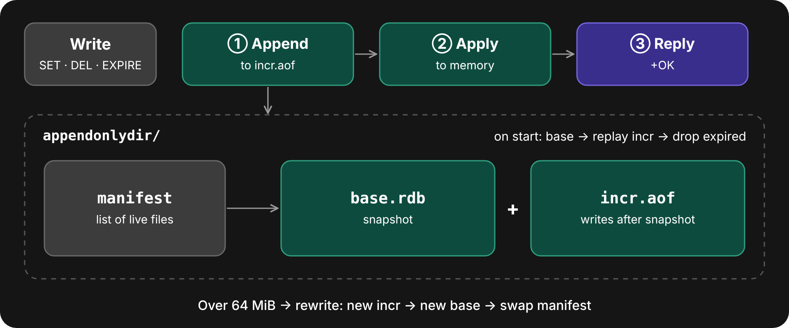

<div align="center">


# Mini Redis

### Python 표준 라이브러리로 만든 단일 노드 Redis

**Many connections, one line of execution. Log first, expire lazily.**


[](#quick-start)
[](#design-goals)
[](#client-side)
[](#engine-side)
[](#benchmark)

</div>

<br />

## Quick Start

Python 3.9+, 외부 패키지 없음.

```sh
python3 -m miniredis                  # 127.0.0.1:6379, ./appendonlydir/에 저장
```

```sh
redis-cli SET visits 9 EX 60          # OK
redis-cli INCR visits                 # 10
redis-cli HSET user:42 city Seoul     # (integer) 1
redis-cli TTL visits                  # (integer) 60
```

Memory only: `python3 -m miniredis -addr 127.0.0.1:6380 -aof ''`

<br />

## Design Goals

| Goal | Solution | Code |
| --- | --- | --- |
| **Concurrency** | Single thread. `asyncio` event loop 1개 + `await` 없는 `execute` → 명령이 섞이지 않아 lock 불필요 | [server.py](miniredis/server.py) · [engine.py](miniredis/engine.py) |
| **Expired keys** | Lazy: 읽을 때 지우고 nil · Active: 0.1초마다 20개씩 정리 | [engine.py](miniredis/engine.py) |
| **API** | Redis와 같은 RESP2 over TCP → `redis-cli` 그대로 사용. HTTP cache 예제 포함 | [resp.py](miniredis/resp.py) · [examples/](examples) |
| **Invalidation** | `DEL` · `EXPIRE` · `SET` 덮어쓰기. 모두 AOF에 남아 재시작 후에도 유지 | [engine.py](miniredis/engine.py) |
| **Crash safety** | AOF first, memory second. base RDB + incr AOF + manifest로 복구 | [persist.py](miniredis/persist.py) |

<br />

## Client Side

### Request Flow


1. **Read** — 연결마다 RESP2 frame을 하나씩 읽음. 기다리는 동안 다른 연결 처리
2. **Execute** — `Engine.execute`가 명령 하나를 끝까지 실행
3. **Log** — 쓰기는 AOF에 먼저 기록, 성공하면 메모리 반영
4. **Reply** — RESP2로 응답. pipeline은 보낸 순서대로

### Commands

| Type | Commands |
| --- | --- |
| String | `SET` (`EX`, `NX`) · `GET` · `INCR` · `MSET` · `MGET` |
| Hash | `HSET` · `HGET` |
| Key | `DEL` · `EXISTS` · `TYPE` · `EXPIRE` · `TTL` |
| Server | `PING` · `BGREWRITEAOF` |

### Use as an API — Cache Example

SQLite 주문 8만 건 집계를 Mini Redis에 캐시하는 HTTP API.

```sh
python3 -m examples.cache_api --db orders.sqlite3 --cache on --ttl 30
curl -i http://127.0.0.1:8080/reports/1    # X-Cache: MISS → SQLite 집계 후 SET ... EX 30
curl -i http://127.0.0.1:8080/reports/1    # X-Cache: HIT  → Mini Redis에서 응답
```

DB가 바뀌면 `DEL`로 바로 무효화. Mini Redis가 꺼져 있으면 `X-Cache: UNAVAILABLE`로 SQLite 결과 반환.

<br />

## Engine Side

### Architecture


| Layer | Role |
| --- | --- |
| ① Access | TCP 연결 · RESP2 읽기/쓰기. 64개 명령마다 loop에 양보 |
| ② Execute | 명령 검사 · keyspace 읽기/쓰기 · 만료 판정 |
| ③ Persist | AOF 기록 · RDB snapshot · 시작 시 복구 |
| Background | 0.1초마다 만료 정리 · fsync · rewrite 조각 쓰기 |

### Concurrency — Single Thread


연결은 여러 개, 실행은 한 줄. `await`는 socket I/O에만 있고 `execute`는 동기 함수라 **명령 단위로 atomic**. `INCR`을 동시에 보내도 값이 꼬이지 않음. 실제 Redis도 명령 실행은 thread 하나.

### Keyspace — HashTable


- 키 → `hash(key)`로 bucket 결정
- 충돌 → 같은 bucket 안에서 `next`로 연결 (chaining)
- 키가 3/4 넘게 차면 bucket 2배
- 삽입 순서 목록 → `purge()`가 앞에서부터 검사

[`HashTable`](miniredis/hashtable.py)은 직접 구현. hash의 field는 Python `dict` 사용.

### Expiration


만료 시각은 키마다 absolute ms로 저장. 읽을 때 지났으면 지우고 nil, 아무도 안 읽는 키는 `purge()`가 정리.

### Invalidation

| Command | Effect | AOF |
| --- | --- | --- |
| `DEL k` | 즉시 삭제 | `DEL k` (있던 키만) |
| `EXPIRE k s` | 기한 예약, 0 이하면 즉시 삭제 | `PEXPIREAT k <ms>` |
| `SET k v` | 새 값으로 교체, TTL 해제 | `SET k v [PXAT <ms>]` |

### Persistence



Redis 7과 같은 `appendonlydir/` 구조.

- **manifest** — 지금 읽을 파일 목록
- **base.rdb** — 한 시점의 snapshot
- **incr.aof** — snapshot 이후 쓰기 기록

rewrite 중에 꺼져도 manifest가 이전 파일을 가리켜 안전.

| `-appendfsync` | fsync | 전원이 꺼지면 |
| --- | --- | --- |
| `always` | 응답 전 매번 | 손실 없음 |
| `everysec` (default) | 약 1초마다 | 최대 약 1초 |
| `no` | OS에 맡김 | OS에 따라 |

<br />

## Benchmark

### Cache On vs Off

주문 8만 건, 보고서 8개를 client 하나가 순환 요청. 요청마다 새 HTTP 연결, 응답은 SQLite 원본과 대조.


| Mode | Requests | Median | p95 | Throughput |
| --- | ---: | ---: | ---: | ---: |
| Cache off · SQLite | 4,800 | 1.427 ms | 1.551 ms | 691.7 req/s |
| Cache on · Mini Redis hit | 4,800 | **0.211 ms** | **0.253 ms** | **4,469.6 req/s** |

<sub>commit `7cc4efa` · Mac mini Linux VM (aarch64, 4 cores) · Python 3.10.12 · SQLite 3.37.2 · 800 req × 6 rounds · [result JSON](benchmarks/results/2026-11-17-7cc4efa-cache-api.json) · [code](benchmarks/cache_api.py)</sub>

```sh
python3 -m benchmarks.cache_api --requests 800 --rounds 6
```

### vs Redis 7

같은 기기에서 `redis-benchmark`로 SET · GET 측정. 양쪽 모두 persistence off.

| req/s | Mini Redis | Redis 7.0.15 | Gap |
| --- | ---: | ---: | ---: |
| SET · no pipeline | 17,989 | 104,493 | 5.8× |
| GET · no pipeline | 19,912 | 106,045 | 5.3× |
| SET · pipeline 16 | 21,249 | 1,234,568 | 58× |
| GET · pipeline 16 | 24,612 | 1,587,302 | 64× |

하나씩 보내면 network 왕복이 대부분이라 약 5배 차이. pipeline으로 몰아 보내면 실행 속도 차이(Python vs C)가 그대로 드러남.

<sub>Linux x86_64, 2 vCPU · Python 3.13.18 · 50 clients · 100k req × 3 rounds, median · [result JSON](benchmarks/results/2026-11-17-vs-redis-linux-x64.json) · [code](benchmarks/vs_redis.py)</sub>

```sh
python3 -m benchmarks.vs_redis       # redis-server, redis-benchmark 필요
```

<details>
<summary>Hash fields: dict vs custom HashTable</summary>

<br />

field 저장소를 `dict`(`9f67b74`)와 `HashTable`(`de7f275`)로 비교. 결과에 따라 `dict` 선택.

| Command (per op) | dict | HashTable |
| --- | ---: | ---: |
| `HSET` new field | **1.518 µs** | 2.842 µs |
| `HSET` update | **1.505 µs** | 2.096 µs |
| `HGET` hit | **1.104 µs** | 1.392 µs |

<sub>1,024 keys × 16 fields · Apple M4 · macOS 15.3.2 · CPython 3.9.6 · median of 8 rounds · [result JSON](benchmarks/results/hash-fields-m4-python39.json) · [code](benchmarks/hash_fields.py)</sub>

</details>

<br />

## FAQ

**Why not multi-thread?**<br />
명령 하나는 몇 µs라 병목은 CPU가 아니라 network I/O. I/O는 event loop로 겹치고 실행은 한 줄로 세워 lock과 race condition을 없앰.

**Trade-off?**<br />
CPU core 하나만 사용. `HashTable` resize나 RDB snapshot 복사 중에는 다른 연결도 잠시 대기.

**프로세스가 죽으면?**<br />
AOF 기록은 응답 전에 OS로 넘어가 있어 남음. 기기 전원이 꺼질 때만 `everysec` 기준 마지막 약 1초 손실 가능.

<br />

## Test

```sh
python3 -m unittest discover -v
```

`redis-server`가 PATH에 있으면 실제 Redis와 응답을 비교하고, 서로의 RDB · AOF를 읽는지 검사.

[Docs: 실행 흐름 · HashTable · 복구](docs/guide.md)
