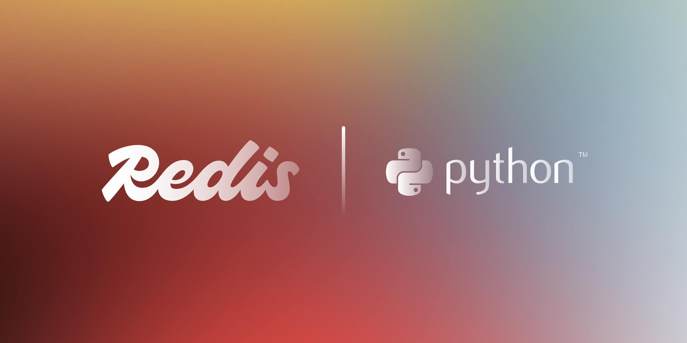
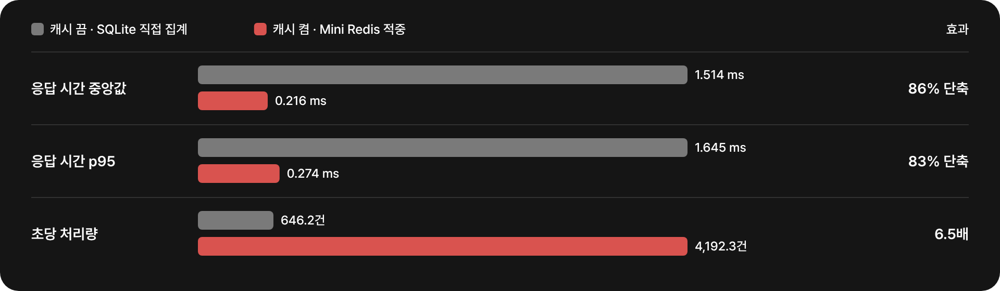
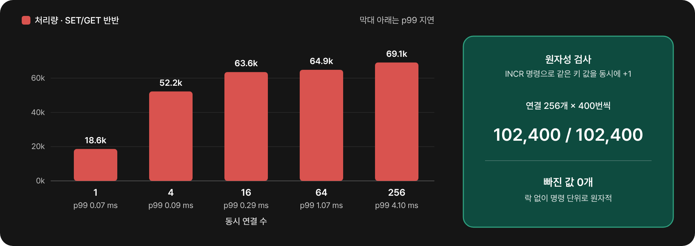

<div align="center">




# Mini Redis

### Python 표준 라이브러리로 만든 단일 노드 Redis

**연결은 여러 개, 실행은 한 줄로. 기록은 먼저, 만료는 접근할 때와 0.1초마다.**


[](#quick-start)
[](#design-goals)
[](#client-side)
[](#engine-side)
[](#benchmark)

</div>

<br />

## Quick Start

Python 3.9 이상, 외부 패키지 없음.

```sh
python3 -m miniredis                  # 127.0.0.1:6379에서 실행, 현재 폴더에 RDB · AOF 저장
```

```sh
redis-cli SET visits 9 EX 60          # OK
redis-cli INCR visits                 # 10
redis-cli HSET user:42 city Seoul     # (integer) 1
redis-cli TTL visits                  # (integer) 60
```

메모리 전용으로 실행: `python3 -m miniredis -addr 127.0.0.1:6380 -aof ''`

<br />

## Design Goals

| 과제 | 해결 | 코드 |
| --- | --- | --- |
| **동시성** | 싱글 스레드. 이벤트 루프 1개가 모든 연결을 받고, 명령은 비동기 없이 동기 방식으로 하나씩 끝까지 실행 → 명령이 섞이지 않아 락 불필요 | [server.py](miniredis/server.py) · [engine.py](miniredis/engine.py) |
| **만료된 값** | 접근할 때 검사해 삭제 + 0.1초마다 20개씩 이어서 정리 | [engine.py](miniredis/engine.py) |
| **외부 API** | Redis와 같은 RESP2 프로토콜 → `redis-cli` 그대로 사용. HTTP 캐시 예제 포함 | [resp.py](miniredis/resp.py) · [examples/](examples) |
| **무효화** | `DEL` · `EXPIRE` · `SET` 덮어쓰기. 모두 AOF에 기록돼 재시작 후에도 유지 | [engine.py](miniredis/engine.py) |
| **서버 다운 대비** | AOF에 먼저 기록 → 메모리 반영. 재시작하면 RDB 스냅샷 + AOF 기록으로 복구 | [persist.py](miniredis/persist.py) |

<br />

## Client Side

### 요청 흐름


1. **읽기** — 연결마다 RESP2 명령을 하나씩 읽음. 기다리는 동안 다른 연결 처리
2. **실행** — 명령 하나를 끝까지 실행. 쓰기는 AOF에 먼저 기록한 뒤 메모리 반영
3. **응답** — RESP2로 돌려줌. 파이프라인은 보낸 순서대로

### 지원 명령

| 종류 | 명령 |
| --- | --- |
| 문자열 | `SET` (`EX`, `NX`) · `GET` · `INCR` · `MSET` · `MGET` |
| 해시 | `HSET` · `HGET` |
| 키 | `DEL` · `EXISTS` · `TYPE` · `EXPIRE` · `TTL` |
| 서버 | `PING` · `BGREWRITEAOF` |

<br />

## Engine Side

### 전체 구조


| 레이어 | 역할 |
| --- | --- |
| ① 접근 | TCP 연결 · RESP2 읽기/쓰기 |
| ② 실행 | 명령 검사 · 키 공간 읽기/쓰기 · 만료 판정 |
| ③ 보존 | AOF 기록 · RDB 스냅샷 · 시작할 때 복구 |
| 0.1초 루프 | 만료 키 정리 · AOF fsync · rewrite 이어 쓰기 |

### 동시성 — 싱글 스레드


연결은 여러 개, 실행은 한 줄. 서버가 기다리는(비동기) 건 네트워크에서 요청이 올 때뿐이고, 명령 실행(`execute`)은 동기 방식이라 시작하면 중간에 멈추지 않고 끝까지 처리. 그래서 실행 도중 다른 명령이 끼어들 수 없어 **명령 단위로 원자적**. 예를 들어 여러 연결이 `INCR` 명령으로 같은 키의 값을 동시에 1씩 올려도, 차례로 하나씩 처리되니 빠지는 값 없이 정확히 더해지고 AOF에도 처리된 순서 그대로 기록됨. 실제 Redis도 명령 실행은 스레드 하나.

### 키 공간 — HashTable


직접 구현한 [`HashTable`](miniredis/hashtable.py). 충돌하면 같은 버킷에 `next`로 연결(chaining)하고, 3/4 넘게 차면 버킷 수를 2배로 늘림. 해시 타입의 필드는 Python `dict` 사용.

### 만료


- **접근 시 검사** — 읽을 때 만료됐으면 지우고 nil
- **0.1초 루프** — 앞에서 20개씩 검사, 살아 있는 키는 뒤로 보내 다음 루프가 이어서 검사

### 무효화

| 명령 | 동작 | AOF 기록 |
| --- | --- | --- |
| `DEL k` | 즉시 삭제 | `DEL k` (있던 키만) |
| `EXPIRE k s` | 만료 시각 예약, 0 이하면 즉시 삭제 | `PEXPIREAT k <ms>` |
| `SET k v` | 새 값으로 교체, TTL 해제 | `SET k v [PXAT <ms>]` |

### 영속화


- **AOF 기록** — 쓰기 명령을 순서대로 이어 쓴 파일
- **RDB 스냅샷** — 어느 시점의 전체 데이터

재시작하면 RDB 스냅샷을 읽고 그 이후의 AOF 기록을 재생해 복구. AOF가 커지면 rewrite로 현재 데이터를 새 RDB 스냅샷으로 압축. rewrite 도중에 꺼져도 이전 파일로 복구됨. 파일 형식은 실제 Redis 7과 같음.

| `-appendfsync` | 디스크 동기화 | 전원이 꺼지면 |
| --- | --- | --- |
| `always` | 응답 전 매번 | 손실 없음 |
| `everysec` (기본값) | 약 1초마다 | 최대 약 1초 손실 |
| `no` | OS에 맡김 | OS에 따라 다름 |

<br />

## Benchmark


<sub>모든 결과 · commit `c87d673` · Mac mini Linux VM (aarch64, 4코어) · Python 3.10.12 · 파이프라인 없이 응답을 받은 뒤 다음 요청</sub>

### 캐시 사용 전후



주문 8만 건, 보고서 8개를 순환 요청. 캐시 적중 시 응답 시간 중앙값 86% 감소, 처리량 6.5배.

### 동시 연결



연결 16개부터 63.6k~69.1k ops/s로 포화되고 256개까지 떨어지지 않음. 늘어나는 건 대기 시간(p99)뿐. 256개 연결이 `INCR` 명령으로 같은 키의 값을 동시에 1씩, 모두 102,400번 올려도 결과는 정확히 102,400 (빠진 값 0).

### 영속화 비용


기본값 `everysec`는 메모리 전용 처리량의 85% 유지. `always`는 쓰기마다 디스크 동기화를 해서 11%.

### rewrite 후 재시작


같은 키 20,000개를 10번씩 덮어쓴 SET 200,000건. rewrite로 RDB 스냅샷을 만들면 파일 크기 93% 감소, 재시작 9.1배 빠름.

```sh
python3 -m benchmarks.cache_api --requests 800 --rounds 6
python3 -m benchmarks.server
```

<sub>[캐시 결과 JSON](benchmarks/results/2026-11-18-cache-api.json) · [서버 결과 JSON](benchmarks/results/2026-11-18-server.json) · [캐시 측정 코드](benchmarks/cache_api.py) · [서버 측정 코드](benchmarks/server.py)</sub>

<details>
<summary>자세한 수치</summary>

<br />

| 캐시 | 요청 수 | 중앙값 | p95 | 초당 처리량 |
| --- | ---: | ---: | ---: | ---: |
| 끔 · SQLite 직접 집계 | 4,800 | 1.514 ms | 1.645 ms | 646.2건 |
| 켬 · Mini Redis 적중 | 4,800 | 0.216 ms | 0.274 ms | 4,192.3건 |

| 동시 연결 | ops/s | p50 | p99 |
| ---: | ---: | ---: | ---: |
| 1 | 18,645 | 0.051 ms | 0.067 ms |
| 4 | 52,205 | 0.073 ms | 0.088 ms |
| 16 | 63,552 | 0.248 ms | 0.291 ms |
| 64 | 64,870 | 0.985 ms | 1.074 ms |
| 256 | 69,135 | 3.703 ms | 4.099 ms |

| AOF 정책 | ops/s | p50 | p99 |
| --- | ---: | ---: | ---: |
| 메모리 전용 | 50,564 | 1.263 ms | 1.395 ms |
| everysec | 43,102 | 1.474 ms | 1.608 ms |
| always | 5,513 | 11.573 ms | 16.101 ms |

| rewrite | 디스크 파일 크기 | 재시작 시간 |
| --- | ---: | ---: |
| 전 · AOF 기록만 | 13,289,008 B | 824 ms |
| 후 · RDB 스냅샷 | 868,998 B | 90 ms |

<sub>3라운드 × 3초 중앙값 · 키 10,000개 · 값 32 B · 연결 수 테스트는 SET/GET 반반 · AOF 테스트는 SET만, 연결 64개</sub>

</details>

<details>
<summary>해시 필드 저장소: dict vs 직접 만든 HashTable</summary>

<br />

필드 저장소를 `dict`(`9f67b74`)와 `HashTable`(`de7f275`)로 비교. 결과에 따라 `dict` 선택.

| 명령 (1회당) | dict | HashTable |
| --- | ---: | ---: |
| `HSET` 새 필드 | **1.518 µs** | 2.842 µs |
| `HSET` 기존 필드 | **1.505 µs** | 2.096 µs |
| `HGET` 있는 필드 | **1.104 µs** | 1.392 µs |

<sub>키 1,024개 × 필드 16개 · Apple M4 · macOS 15.3.2 · CPython 3.9.6 · 8라운드 중앙값 · [결과 JSON](benchmarks/results/hash-fields-m4-python39.json) · [측정 코드](benchmarks/hash_fields.py)</sub>

</details>

<br />

## FAQ

**왜 멀티 스레드가 아닌가요?**<br />
명령 하나를 처리하는 데는 몇 µs(100만분의 1초)밖에 안 걸립니다. 느린 쪽은 CPU가 아니라 요청이 네트워크로 오가는 시간입니다. 그래서 기다리는 일은 이벤트 루프가 여러 연결을 번갈아 맡고, 실제 실행은 한 줄로 세웠습니다. 실행하는 스레드가 하나뿐이라 서로 값을 덮어쓸 일이 없고, 락도 필요 없습니다.

**대신 포기한 것은?**<br />
CPU 코어를 하나만 씁니다. 그리고 오래 걸리는 작업이 도는 동안에는 다른 요청도 잠깐 기다립니다. 키가 많아져 HashTable을 2배로 늘릴 때나, RDB 스냅샷을 만들 때가 그렇습니다.

**서버가 갑자기 죽으면 데이터가 사라지나요?**<br />
쓰기 명령은 응답하기 전에 AOF에 기록해 운영체제에 넘겨 두기 때문에, 서버 프로세스가 죽어도 기록은 남습니다. 컴퓨터 전원 자체가 꺼지는 경우에만 기본 설정(`everysec`)에서 마지막 약 1초 분량이 사라질 수 있습니다.

[자세한 문서: 실행 흐름 · HashTable · 복구](docs/guide.md)
